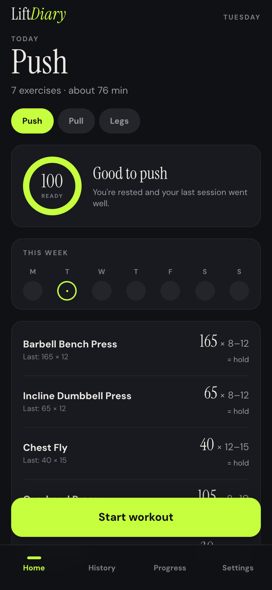
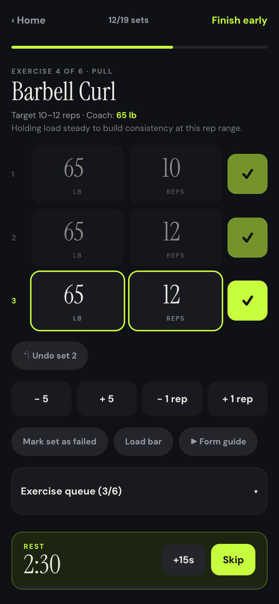
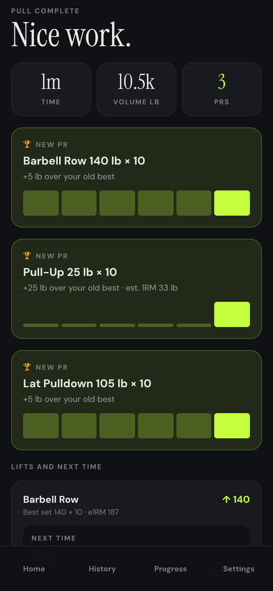
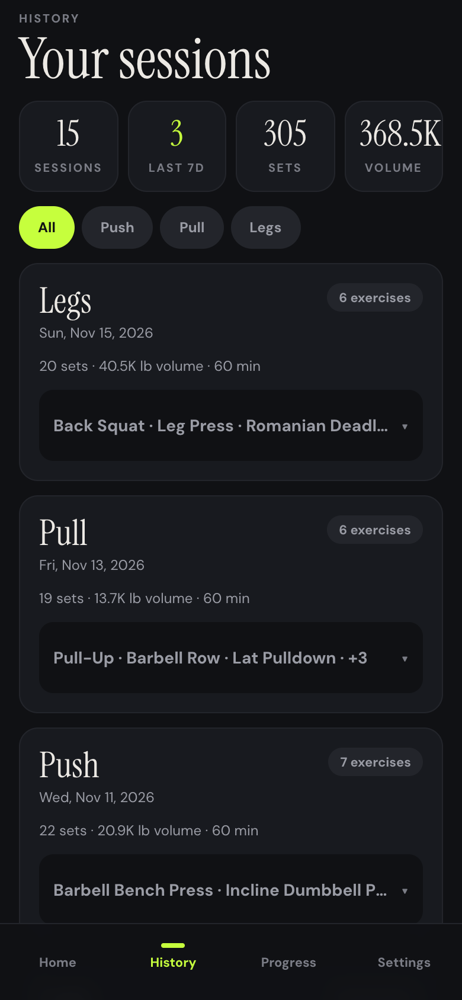
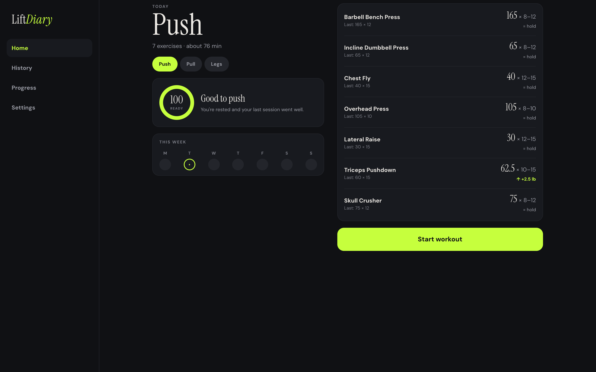
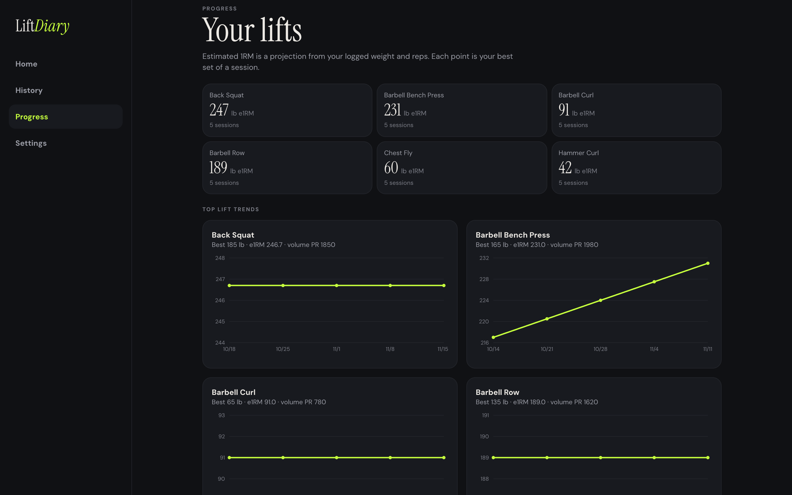

# LiftDiary

[](https://github.com/amanavi007/LiftDiary/actions/workflows/ci.yml)

A workout log with a coach that learns your numbers. Log sets in one tap, get a recommended weight for every lift, and see your progress over time. It works on a phone at the gym and on a laptop at home.

<p align="center">
  
  
  
  
</p>

<p align="center">
  
  
</p>

## Features

- **Fast set logging.** Weight and reps are pre-filled from the coach's suggestion, a set is one tap, and the rest timer starts on its own. It stays accurate if your phone sleeps, because it counts down to an end time instead of ticking.
- **A coach that adapts.** Recommended weights come from a hybrid engine: a calibration phase for your first workouts, a deterministic progression rule when data is thin, and a small linear-regression model once there is enough history. Every suggestion comes with a plain-language reason and a confidence score.
- **Readiness score.** A 0 to 100 hint on Home from rest days, last session's failed sets, and recent volume spikes. It never blocks a workout.
- **Per-lift trends.** Home shows last time vs today for each lift (up, hold, down); the summary shows PRs with a mini trend; Progress charts your best estimated 1RM per session.
- **Workout flexibility.** Swap, skip, or reorder exercises mid-workout, load a barbell with the plate calculator, watch a form video, mark a set as failed, or undo the last set.
- **Routine setup.** A guided onboarding flow builds your split (push/pull/legs, upper/lower, full body, bro split, or custom). Optionally import a split from a screenshot using an OpenAI vision model.
- **Your data is yours.** Export your full history as CSV from Settings.
- **Responsive.** Phone layout with a bottom tab bar, and a sidebar plus two-column layouts on laptops.

## Tech stack

| Area | Choice |
| --- | --- |
| Framework | Next.js 16 (App Router, server components), React 19, TypeScript |
| Styling | Tailwind CSS 4, a small design system in `src/components/ui` (Instrument Serif and DM Sans) |
| Data | PostgreSQL with Prisma |
| Auth | Email and password, bcrypt hashing, signed JWT in an HTTP-only cookie (`jose`), in-memory rate limiting on auth routes |
| Validation | Zod on the routes that accept request bodies (auth, onboarding, sets, settings) |
| Charts | Recharts |
| AI (optional) | OpenAI vision model for importing a split from a screenshot |
| Tests | Vitest (unit tests for all of the pure logic) |
| CI | GitHub Actions: lint, type-check, test, build |

## Getting started

You need Node 20.9 or newer and a PostgreSQL database (a free [Neon](https://neon.tech) or [Supabase](https://supabase.com) database works, or run Postgres locally).

```bash
git clone https://github.com/amanavi007/LiftDiary.git
cd LiftDiary
npm install
cp .env.example .env        # then fill in DATABASE_URL and JWT_SECRET
npm run db:push             # create the tables
npm run db:seed             # load the exercise library
npm run dev                 # http://localhost:3000
```

To skip onboarding and look around with realistic data, create a demo account with five weeks of history:

```bash
npx tsx --env-file=.env scripts/create-demo-account.ts
# default login: demo@liftdiary.app / LiftDemo2026!
# change it with DEMO_EMAIL and DEMO_PASSWORD
```

### Environment variables

| Variable | Required | Purpose |
| --- | --- | --- |
| `DATABASE_URL` | yes | PostgreSQL connection string |
| `JWT_SECRET` | yes | Signs session cookies (`openssl rand -base64 32`) |
| `OPENAI_API_KEY` | no | Enables the screenshot split import |
| `OPENAI_VISION_MODEL` | no | Overrides the default vision model (`gpt-4.1-mini`) |

### Scripts

| Command | What it does |
| --- | --- |
| `npm run dev` | Start the dev server |
| `npm run build` / `npm start` | Production build and server |
| `npm test` | Run the unit tests |
| `npm run lint` | ESLint |
| `npm run db:push` | Sync the Prisma schema to the database |
| `npm run db:seed` | Seed the exercise library |

## How it works

```
src/
  app/            Pages (home, workout, history, dashboard, settings, auth, onboarding)
    api/          Route handlers (auth, sessions, sets, routines, export, ...)
  components/
    ui/           Design-system pieces (Card, Button, Ring, SetRow, nav, ...)
    workout/      Logger parts (rest timer, plate sheet, exercise queue, ...)
  lib/            Pure, tested logic and data loading
prisma/           Schema and seed (large exercise library)
scripts/          Demo account generator
docs/             Design spec and screenshots
```

**Recommendation engine** (`src/lib/recommendation.ts`). During your first few workouts (calibration) it suggests your last working weight. With little history it falls back to a deterministic rule that adds weight when you hit the top of your rep range and holds or lowers it when you miss. Once there is enough data it fits a small linear regression over recent performance (previous weight, reps achieved, moving estimated 1RM, days since last session, goal, coaching style), bounds the result to a safe jump, and rounds to real plate increments.

**Things I paid attention to**

- Pure logic (readiness, trends, streaks, weekly strip, rest timer, CSV, recommendation math) lives in `src/lib` with unit tests, separate from the UI.
- API routes scope every query to the signed-in user, validate request bodies with Zod, and guard against double-submitted sets on the server as well as the client.
- Dates are formatted in the viewer's time zone, not the server's.
- CSV export neutralises spreadsheet formula injection.

## Design

Dark and flat: near-black `#101114` with one lime accent, Instrument Serif for headlines and numbers, DM Sans for text. The layout borrows from WHOOP's "one decision first, details on demand" pattern: Home answers "what am I doing today and am I ready?" before anything else. The reasoning, research notes, and decisions are in [`docs/design-spec.md`](docs/design-spec.md).

## Deploying

The app deploys to Vercel with no extra configuration. Add `DATABASE_URL` and `JWT_SECRET` (and optionally `OPENAI_API_KEY`) as environment variables, run `npm run db:push` and `npm run db:seed` once against the production database, and deploy.

The auth rate limiter keeps its counters in memory, which suits a single server. On serverless platforms with many instances, swap the store in `src/lib/rate-limit.ts` for Redis or an edge key-value store.

## Roadmap

- Persist exercise swaps across page reloads
- Per-exercise notes and supersets
- Apple Health / Google Fit import
- PWA install and offline logging
